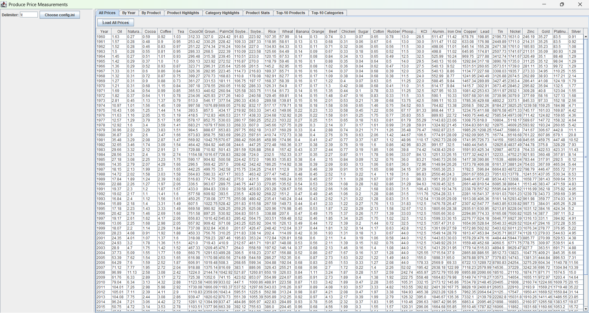
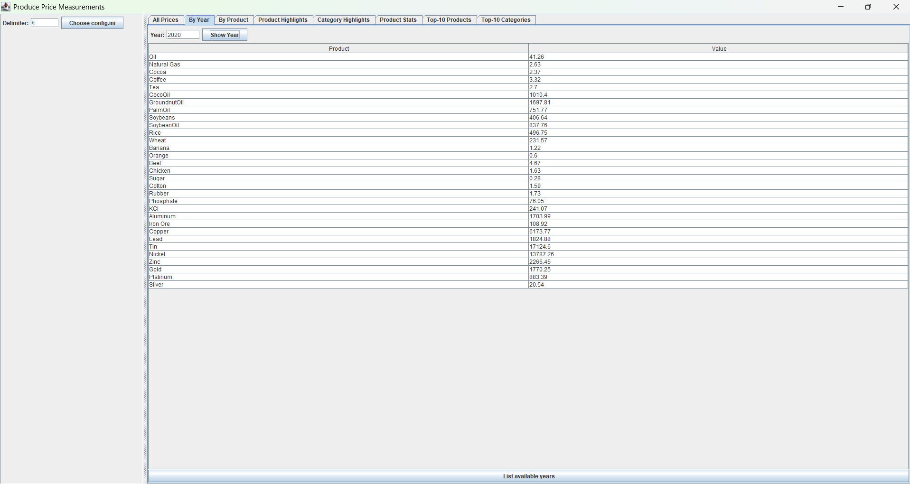
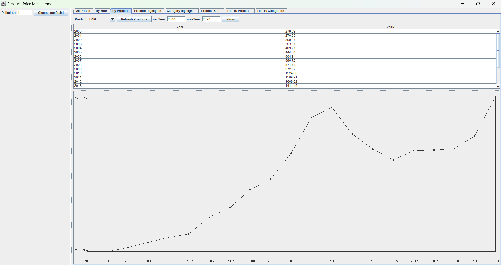
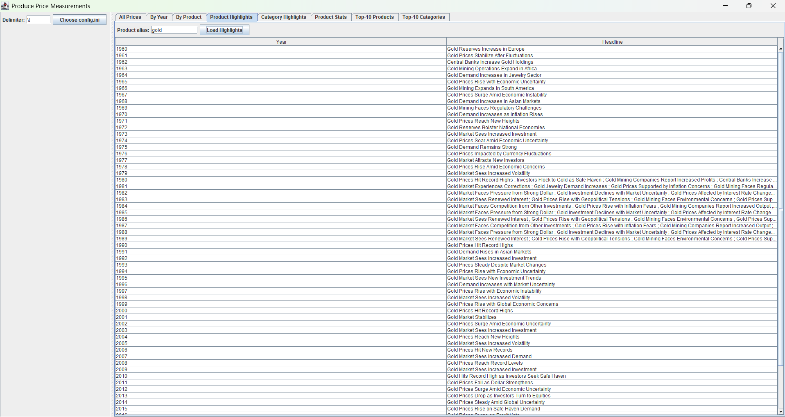
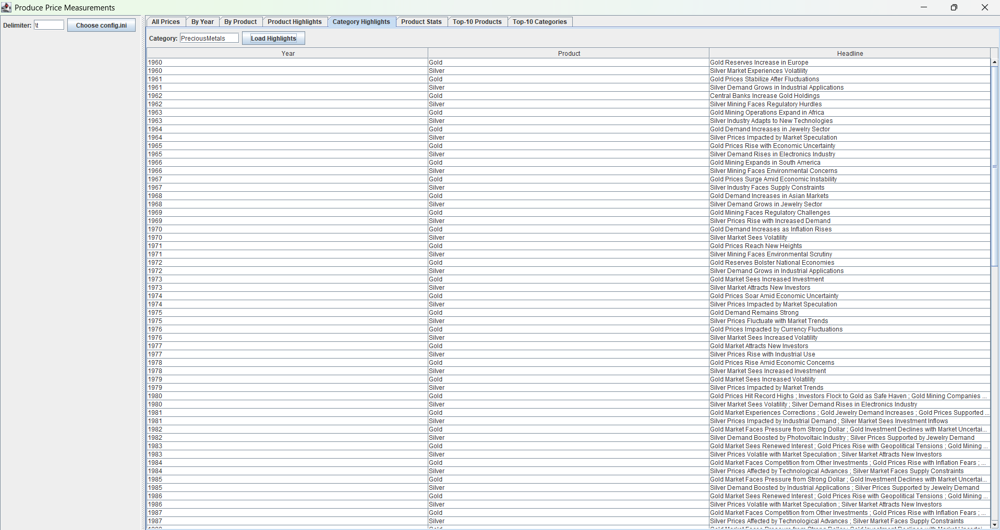
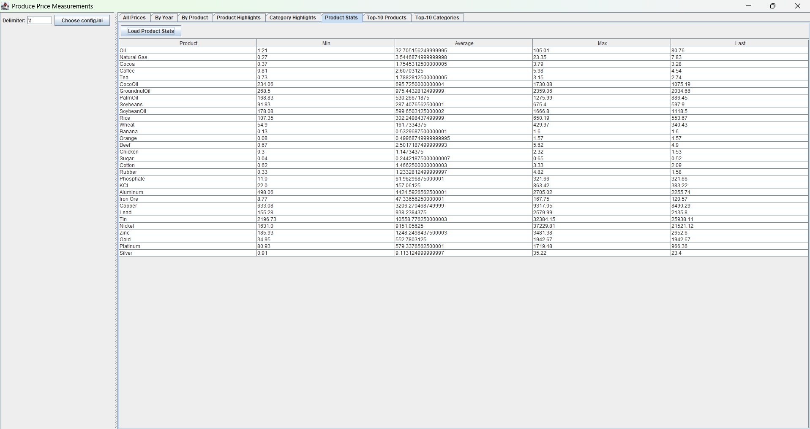
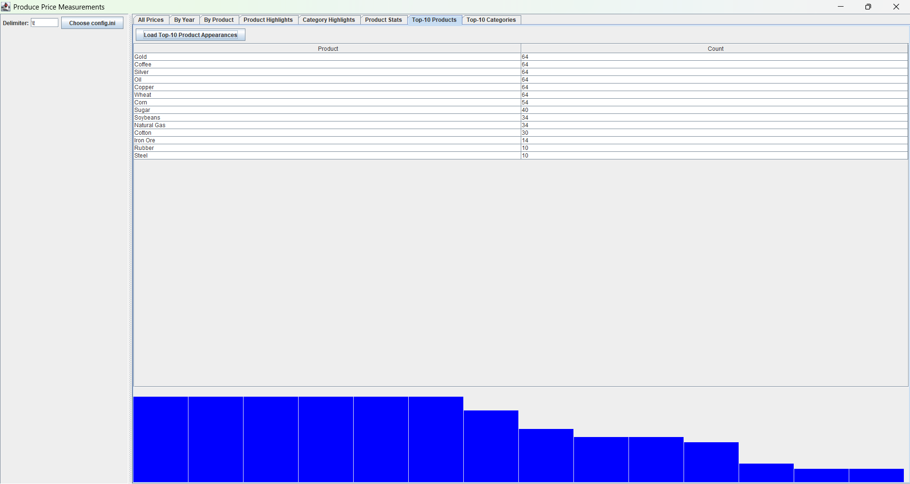
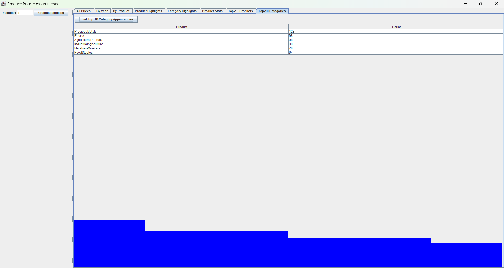
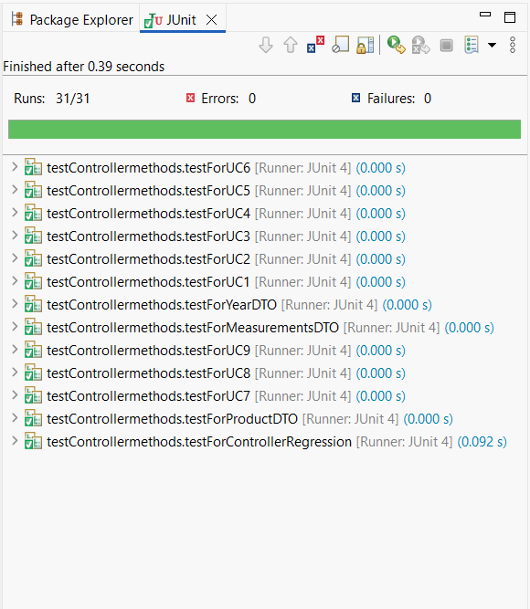
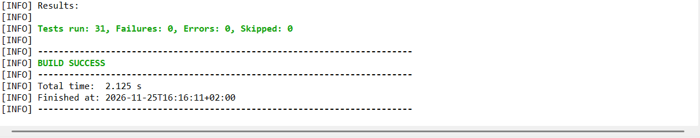

# Product Price Data Manager

A Java desktop application for historical product price analysis,
data processing, statistical calculations and reporting.

Developed as an academic team project for the Software Development
course at the University of Ioannina.

The project focuses on implementing the backend business logic
of a provided application framework, integrating it with an existing
graphical user interface and validating its functionality through
automated software testing.

## Project Scope and Contribution

The initial application framework was provided as part of the
academic assignment.

The provided components included:

- Java Swing graphical user interface (GUI)
- Command-line interface (CLI)
- Controller interface (IController)
- Controller factory
- Data Transfer Objects (DTOs)
- Input datasets and metadata
- Technical report template

The student team's contribution included:

- Complete implementation of ControllerImplementation
- Implementation of all 13 methods defined by IController
- File parsing and data loading
- In-memory data management
- Data retrieval and filtering algorithms
- Statistical calculations
- Product and category reports
- Automated JUnit tests
- Requirements analysis and use case documentation
- Requirements traceability
- Software design documentation

The backend implementation was integrated with the existing
application framework without modifying its public controller
interface.

## Features

- Initialization from INI configuration files
- Loading and processing structured data files
- Product and metadata management
- Historical product price retrieval
- Filtering measurements by year and product
- Filtering measurements within a specified year range
- Product highlights and associated headlines
- Category highlights and associated headlines
- Statistical analysis of product prices
- Top-10 product appearance analysis
- Top-10 category appearance analysis
- Integration with the existing graphical and command-line clients

## Technologies and Tools

### Programming Language

- Java 8

### Application Framework

- Java Swing (provided GUI)
- Java Collections Framework
- Java File I/O

### Data Formats

- TSV (Tab-Separated Values)
- CSV (Comma-Separated Values)
- INI configuration files

### Build and Testing Tools

- Apache Maven
- JUnit 4.13.2
- Maven Surefire Plugin 3.2.5

### Development Environment

- Eclipse IDE

## Application Screenshots

The following screenshots demonstrate the functionality of the
backend implementation through the provided Java Swing interface.

The application processes an academic dataset containing historical
product price measurements across 64 years, with price columns
for 31 products.

### All Product Prices

Displays historical prices for all available products and years.



### Prices by Year

Retrieves all available product measurements for a selected year.

The following example displays product prices for 2020.



### Prices by Product

Retrieves and filters historical measurements for a selected product
within a specified year range.

The following example demonstrates the historical price measurements
of Gold between 2000 and 2020.



### Product Highlights

Displays the years in which a selected product appeared in the
Top-10 lists, together with its associated headlines.



### Category Highlights

Retrieves Top-10 appearances and associated headlines for products
belonging to a selected category.

The following example demonstrates the PreciousMetals category.



### Product Statistics

Calculates the following statistics for each product:

- Minimum price
- Average price
- Maximum price
- Last available price



### Top-10 Product Appearances

Counts the number of times each product appears in the yearly
Top-10 lists and sorts the results in descending order.



### Top-10 Category Appearances

Aggregates individual product appearances according to their
associated categories.



## Software Architecture

The application separates presentation logic, business logic
and data transfer responsibilities.

The original architecture was provided as part of the academic
assignment.

| Component | Responsibility |
| --- | --- |
| clients.gui | Application entry point and graphical client |
| clients.gui.ui | User interface panels, tables and charts |
| clients.cli | Command-line client |
| controller | Controller interface, factory and backend implementation |
| dto | Data Transfer Objects |

The graphical and command-line clients communicate with the
backend through the IController interface.

The ControllerFactory provides instances of ControllerImplementation
without requiring the clients to depend directly on its concrete
implementation.

ControllerImplementation contains the business logic responsible
for loading, processing, filtering and analyzing product data.

## Backend Implementation

The main implementation is located in:

`src/main/java/controller/ControllerImplementation.java`

The class implements all 13 methods defined by the IController
interface.

| Method | Responsibility |
| --- | --- |
| initializeFromIni() | Loads data and metadata through an INI configuration file |
| loadFile() | Loads a data file directly |
| listYears() | Returns all available years |
| listProducts() | Returns all available products |
| getYearMeasurements() | Retrieves measurements for a specific year |
| getProductMeasurements() | Retrieves historical product measurements |
| filterProductMeasurements() | Filters product measurements by year range |
| reportProductHighlights() | Retrieves product highlights |
| reportCategoryHighlights() | Retrieves category highlights |
| computeProductStats() | Calculates product statistics |
| computeTop10ProductAppearances() | Counts Top-10 product appearances |
| computeTop10CategoryAppearances() | Counts Top-10 category appearances |
| reportAllYearsAllProductPrices() | Returns all available product prices |

## Data Structures

The backend uses Java collections to organize and process
the dataset in memory.

The main data structures include:

- HashMap
- Nested HashMap
- ArrayList
- List
- Integer arrays

Product prices are organized using a nested HashMap:

```java
HashMap<Integer, HashMap<String, Double>>
```

The outer map associates each year with its corresponding
product measurements.

The inner map associates product aliases with their numerical
price values.

Additional maps maintain relationships between:

- Product aliases and titles
- Product aliases and categories
- Normalized names and product aliases
- Years and Top-10 product appearances
- Years and associated headlines

An ArrayList preserves the original product column order.

## Algorithms and Data Processing

The backend implementation includes:

- Sequential file parsing
- Product alias normalization and lookup
- Hash-based data retrieval
- Selection Sort for chronological year ordering
- Descending sorting of appearance counts
- Year-range filtering
- Frequency counting
- Data aggregation
- Minimum and maximum calculations
- Arithmetic mean calculations
- Latest available measurement retrieval

Missing numerical measurements are excluded from statistical
calculations.

Products without category metadata remain available in product
appearance reports but are excluded from category appearance
reports.

## Design Patterns and Architectural Principles

The provided application architecture incorporates the following
design patterns and architectural concepts.

### Facade

The IController interface provides a unified entry point for
accessing the backend functionality.

### Factory

The ControllerFactory creates controller instances while hiding
the concrete implementation from the application clients.

### Data Transfer Objects (DTOs)

DTO classes transfer structured data between the backend
and the application clients without requiring direct access
to the controller's internal data structures.

The student implementation follows the contracts and architectural
boundaries established by these provided components.

## Requirements Analysis

The academic project was organized around nine functional use cases.

| ID | Use Case |
| --- | --- |
| UC1 | Initialization from a configuration file |
| UC2 | Display all product prices |
| UC3 | Display product prices by year |
| UC4 | Display and filter prices by product |
| UC5 | Product highlights |
| UC6 | Category highlights |
| UC7 | Product statistics |
| UC8 | Top-10 product appearances |
| UC9 | Top-10 category appearances |

Each use case was associated with corresponding backend methods
and automated test scenarios.

## Software Testing

Automated tests were implemented using JUnit 4.

The original academic submission contained 26 tests.

Following the post-submission improvements, five additional
regression tests were introduced, bringing the total to 31 tests.

The tests cover:

- Data initialization and loading
- Product and year retrieval
- Measurement filtering
- Product highlights
- Category highlights
- Statistical calculations
- Top-10 appearance counting
- DTO functionality
- Invalid input handling
- Regression testing

### Happy Day and Rainy Day Scenarios

The original use case tests were organized into two scenarios:

- Happy Day Scenarios: Verify expected behavior with valid input.
- Rainy Day Scenarios: Verify behavior with invalid or exceptional input.

This approach was used to validate the functional requirements
of the application.

### Requirements Traceability

The following table summarizes the relationship between the
functional use cases and their corresponding test classes.

| Use Case | Test Class | Scenarios |
| --- | --- | --- |
| UC1 | testForUC1 | Happy Day / Rainy Day |
| UC2 | testForUC2 | Happy Day / Rainy Day |
| UC3 | testForUC3 | Happy Day / Rainy Day |
| UC4 | testForUC4 | Happy Day / Rainy Day |
| UC5 | testForUC5 | Happy Day / Rainy Day |
| UC6 | testForUC6 | Happy Day / Rainy Day |
| UC7 | testForUC7 | Happy Day / Rainy Day |
| UC8 | testForUC8 | Happy Day / Rainy Day |
| UC9 | testForUC9 | Happy Day / Rainy Day |

### Regression Testing

The additional regression tests verify:

- Preservation of the original dataset results
- Literal handling of special delimiter characters
- Single-line quoted CSV field parsing
- UTF-8 character handling
- Prevention of incorrect substring-based product matching
- Protection of the controller's internal report lists

### Final Test Results

| Test Category | Total | Passed |
| --- | ---: | ---: |
| Functional Use Case Tests | 18 | 18 |
| DTO Tests | 8 | 8 |
| Regression Tests | 5 | 5 |
| **Total** | **31** | **31** |

| Metric | Result |
| --- | ---: |
| Tests executed | 31 |
| Passed | 31 |
| Failures | 0 |
| Errors | 0 |
| Skipped | 0 |
| Success rate | 100% |

All 31 automated tests were successfully executed through
both the Eclipse JUnit test runner and Apache Maven.

### JUnit Test Execution



### Maven Test Execution



## Dataset Validation

Regression testing confirmed that the backend improvements
preserved the following results for the original academic dataset.

| Dataset Metric | Result |
| --- | ---: |
| Distinct years | 64 |
| Products with price columns | 31 |
| Total Top-10 product appearances | 610 |
| Total Top-10 category appearances | 546 |
| Gold highlight records | 64 |
| PreciousMetals highlight records | 128 |

The difference between product and category appearance counts
is caused by products without corresponding category metadata.

The original academic dataset was preserved without modification.

The dataset is used for academic and demonstration purposes
and does not represent a live financial data service.

## Post-Submission Improvements

Following the original academic submission, the project was
improved in preparation for portfolio presentation.

The improvements include:

- Maven dependency configuration
- Maven Surefire test discovery configuration
- Explicit UTF-8 file reading
- Literal delimiter handling
- Support for single-line quoted CSV fields
- Improved product alias matching
- Protection of internal controller collections
- Improved source code documentation
- Stronger assertions in existing tests
- Five additional regression tests
- Improved project documentation

These improvements were prepared with AI-assisted code review
and code revisions, and validated through automated testing.

The original controller interface, factory, graphical user
interface, command-line interface and DTO classes were preserved.

## Software Engineering Skills

The project demonstrates experience with:

- Java Programming
- Backend Development
- Object-Oriented Programming (OOP)
- Interface Implementation
- Encapsulation and Abstraction
- Polymorphism
- Separation of Concerns
- Data Structures and Algorithms
- File Handling
- Data Parsing
- Data Processing
- Statistical Analysis
- Integration with Existing Codebases
- Software Testing
- Regression Testing
- Requirements Analysis
- Requirements Traceability
- Technical Documentation
- Team Collaboration

## Project Structure

```text
product-price-data-manager/
├── docs/
│   └── screenshots/
├── src/
│   ├── main/
│   │   ├── java/
│   │   │   ├── clients/
│   │   │   │   ├── cli/
│   │   │   │   └── gui/
│   │   │   │       └── ui/
│   │   │   ├── controller/
│   │   │   │   ├── ControllerFactory.java
│   │   │   │   ├── ControllerImplementation.java
│   │   │   │   └── IController.java
│   │   │   └── dto/
│   │   └── resources/
│   │       └── config/
│   │           └── config.ini
│   └── test/
│       ├── java/
│       │   └── testControllermethods/
│       └── resources/
│           └── Input/
├── .gitignore
├── pom.xml
└── README.md
```

## Getting Started

### Prerequisites

- Java Development Kit (JDK 8)
- Apache Maven
- Eclipse IDE (optional)

### Import into Eclipse

1. Open Eclipse IDE.
2. Select File > Import.
3. Select Maven > Existing Maven Projects.
4. Select the root directory of the project.
5. Import the project and allow Maven to resolve its dependencies.

### Configuration

The application uses the following configuration file:

`src/main/resources/config/config.ini`

The configuration file contains the paths to the data
and metadata files:

```ini
dataFile=src/test/resources/Input/data.tsv
metadataFile=src/test/resources/Input/metadata.tsv
```

The paths are relative to the project root directory.

### Running the Application in Eclipse

1. Open the clients.gui package.
2. Locate AppMain.java.
3. Right-click the file.
4. Select Run As > Java Application.
5. Click Choose config.ini.
6. Select the configuration file.
7. Use `\t` as the delimiter for TSV data.
8. Select the desired application tab and load its results.

### Running the Application from the Command Line

From the root directory of the project, compile the application:

```bash
mvn compile
```

Then launch the graphical client:

```bash
java -cp target/classes clients.gui.AppMain
```

Run these commands from the project root so that the relative
dataset paths can be resolved.

### Running the Automated Tests

Execute the following command from the root directory:

```bash
mvn test
```

Alternatively, within Eclipse:

- Right-click the testControllermethods package.
- Select Run As > JUnit Test.

To execute a clean build and run the tests:

```bash
mvn clean test
```

## Academic Information

- University: University of Ioannina
- Department: Computer Science and Engineering
- Course: Software Development
- Academic Year: 2025-2026
- Project Type: Academic Team Project
- Team Size: 2 students
- Original Programming Language: Java 8
- Primary Contribution: Backend Business Logic Implementation
- Original Automated Tests: 26
- Final Automated Tests: 31
- Functional Use Cases: 9

## Team Collaboration

This project was developed collaboratively by a team of two
students, with both members actively participating in the
backend implementation, testing and technical documentation.

## Copyright and Attribution

The original application framework and academic datasets
were provided as part of the Software Development course
at the University of Ioannina.

The original student-developed backend implementation,
tests and technical documentation are attributed to the
student project contributors.

Rights to the provided framework and datasets remain with
their respective rights holders.

This repository is intended for educational and portfolio
purposes.

No open-source license is granted by this README.
